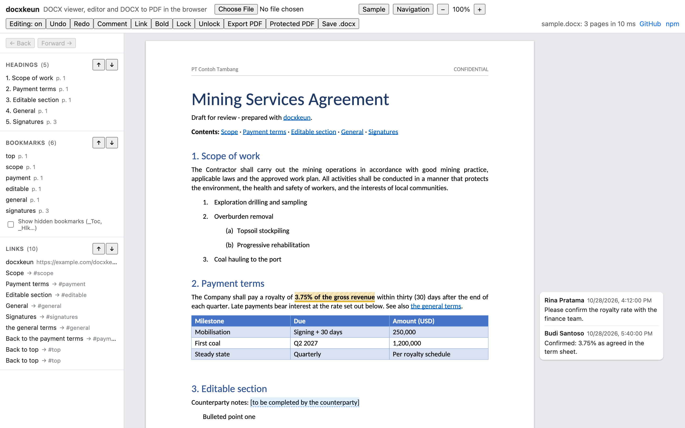

# docxkeun

[](https://github.com/kevinkjs/docxkeun/actions/workflows/ci.yml)
[](https://www.npmjs.com/package/docxkeun)
[](LICENSE)

A DOCX viewer, editor and DOCX-to-PDF converter for JavaScript and TypeScript. Read, render, edit and convert `.docx` files in the browser (and Node), with **zero runtime dependencies**. Everything is implemented in this package: zip, XML, the document model, a page layout engine, an SVG viewer, a PDF writer, and the cryptography for password-protected files.

**[Live demo](https://kevinkjs.github.io/docxkeun/)**: open a `.docx`, type on the page, right-click to comment or link, track changes, undo anything, export a PDF.

[](https://kevinkjs.github.io/docxkeun/)

> **Beta.** docxkeun is new. It is tested against its own test suite and independent implementations, but not yet broadly against files made by Microsoft Word. See [Status and limitations](#status-and-limitations), and please [report](https://github.com/kevinkjs/docxkeun/issues) documents that render or save wrongly.

| Area | What you get |
|---|---|
| Read / write | Open `.docx` (also `.dotx`/`.docm`), edit through a code API, save. Parts you did not touch are written back byte-for-byte; unknown markup is preserved. Record, accept and reject tracked changes. |
| Render | Paginated, Word-like layout: styles, lists, tabs, tables, sections, balanced columns, headers/footers, footnotes, page numbers. Pictures (PNG, JPEG, GIF, BMP, TIFF, EMF, WMF), shapes and text boxes, charts, SmartArt and equations, with text wrapping around floating objects. Right-to-left text (Arabic, Hebrew) and complex scripts. One SVG per page with real, selectable text. |
| PDF | Native PDF from the same layout: embedded font subsets, searchable text, links, bookmarks as named destinations, an outline from headings, comments as annotations. |
| Permissions | Word protection (read-only / comments / tracked changes / forms) with editable ranges, an app-level `AccessPolicy`, password-to-open `.docx` encryption, PDF passwords and permission flags. |
| Comments, anchors, links | Threaded comments (all five Word comment parts), bookmarks, internal and external hyperlinks, field-code links. |
| AI assistants | [`docxkeun-mcp`](packages/mcp#readme): an MCP server that lets Claude and other AI assistants read, edit, comment on, protect and export your `.docx` files. |

## Install

```bash
npm install docxkeun docxkeun-fonts
```

`docxkeun-fonts` is optional (about 7 MB of open fonts, see [Fonts](#fonts)); without it the viewer measures the browser's own fonts, and PDF export needs font files you provide.

| Import | What it contains |
|---|---|
| `docxkeun` | Open, create and save documents; fonts; layout; comments |
| `docxkeun/editor` | `DocxEditor`: the code API for changes |
| `docxkeun/viewer` | `DocxViewer`, typing on the page, navigation |
| `docxkeun/pdf` | `exportPdf` |
| `docxkeun/security` | Protection, `AccessPolicy`, password-to-open, PDF security |
| `docxkeun/react` | React binding (bring your own React) |

**Runtime support:** current Chrome, Edge, Firefox and Safari (16.4+), and Node 20.12+. docxkeun is ESM-only; Node 22.12+ can also `require()` it.

## Quick start

```ts
import { openDocx, FontRegistry, loadBundledFonts } from 'docxkeun';
import { DocxViewer } from 'docxkeun/viewer';
import { fontUrls } from 'docxkeun-fonts';

const fonts = new FontRegistry();
await loadBundledFonts(fonts, { urls: fontUrls });       // see "Fonts" below

const viewer = new DocxViewer(document.getElementById('viewer')!, { fonts });
await viewer.load(fileFromInput);                       // Uint8Array | ArrayBuffer | Blob
viewer.on('linkclick', (e) => console.log(e.target));   // call e.preventDefault() to handle it yourself
viewer.scrollToAnchor('payment');                       // bookmarks
```

Without registered fonts the viewer still works: it measures the viewer's system fonts with the canvas API. Exact layout and PDF export need font files.

### Jumping between bookmarks, links and headings

```ts
const { headings, bookmarks, links } = viewer.navigation;   // each in document order, with page and position
viewer.goTo(bookmarks[0], { history: true });                // scroll there; the target briefly lights up
viewer.next('link');      viewer.previous('link');           // also 'bookmark' and 'heading'
viewer.back();            viewer.forward();                  // like a browser, after following an internal link
viewer.on('navigate', ({ target, location }) => highlightInMyPanel(target));
```

- Clicking an internal link jumps to its bookmark and records history, so `back()` returns to the link.
- Each link target has its text (`label`), its `link` (URL or bookmark name) and, for internal links, its `destination`. A link that wraps onto two lines is one target.
- Links in headers and footers are left out, since they repeat on every page.
- Bookmarks whose names start with `_` (`_Toc…`, `_Hlk…`, `_GoBack`) are marked `hidden`, as Word hides them. `next`/`previous` skip them unless you pass `{ includeHidden: true }`.
- `collectNavTargets(layout)` from `docxkeun/viewer` gives the same lists without a viewer (e.g. in Node).

The `navigation` option adds a ready-made panel for these lists (see [Viewer UI](#viewer-ui)); the playground uses it with Alt+←/→ for back and forward.

### Typing on the page

```ts
const viewer = new DocxViewer(el, { fonts, editable: true, toolbar: true });  // or { editable: { guard: policy, trackChanges: true, author: 'Rina' } }
viewer.on('editerror', ({ error }) => toast(error.message));     // e.g. PermissionError under read-only protection
viewer.on('storychange', ({ story }) => console.log(story.kind)); // 'body', 'header', 'footer', 'footnote', 'endnote' or 'textbox'
viewer.editing!.undo();
viewer.setEditable(false);                                       // back to view-only
```

Click to place the caret and type. Supported: text and IME input, Backspace/Delete (Alt/Ctrl for words), Enter (new paragraph, following the style's "next" style), Shift+Enter (line break), Tab, arrow keys, Home/End, Shift to select, double-click a word, drag to select, Cmd/Ctrl+A, Cmd/Ctrl+B/I/U, Cmd/Ctrl+E/L/R/J for alignment, Cmd/Ctrl+Z / Shift+Z / Y for undo and redo, and Cmd/Ctrl-click to follow a link. Every change goes through `DocxEditor`, so the same access guard applies and everything the editor does not understand stays in the file.

- **Headers, footers, notes and text boxes:** double-click a header or footer to type in it (as in Word), click a footnote, endnote or text box to edit it, and click the body to go back.
- **Toolbar:** `toolbar: true` adds a formatting bar above the pages (paragraph style, size, bold/italic/underline/strikethrough, colour, highlight, alignment, lists, indents, text direction, undo/redo, Track Changes). It follows the formatting at the caret through the `caretchange` event, so you can also build your own: `viewer.editing.format({ bold: true })`, `formatParagraphs({ align: 'center' })`, `setStyle('Heading1')`, `setList('bullet')`, `indent(1)`, `trackChanges = true`.
- **Copy and paste keep formatting:** HTML from Word, Google Docs and web pages comes in with bold, italic, underline, colours, sizes, links, headings and lists; copying puts HTML and plain text on the clipboard.
- **Pictures** count as one character: the caret steps over them, and Backspace/Delete removes them.
- **Track Changes:** with Word's Track Changes on (or `trackChanges: true`), typing is recorded as tracked insertions and deletions.
- **Speed:** layout keeps the measured lines of unchanged paragraphs, so a keystroke re-measures only the paragraph you type in (a 90-page document re-lays out in about 45 ms).

### AI assistants on the page

Two pieces for apps that let an AI edit the document (the [chat app](packages/chat#readme) and the MCP [live preview](packages/mcp#live-preview) use both):

```ts
import { describeSelection } from 'docxkeun/editor';

// What the user selected, like the "selected lines" an editor shares with a coding agent.
viewer.on('selectioninfo', ({ selection }) => {
  // { story: 'body', start: { paragraph: 4, offset: 22 }, end: …, text: '30 days', pages: [2], paragraphs: [...] }
  if (selection) prompt.context = describeSelection(selection, { document: 'contract.docx' });
  // "Selected in contract.docx: paragraph 4, page 2, 7 characters.
  //  [4] Payment is due within «30 days» of the invoice date."
});
viewer.selectionInfo();                         // the same, on demand (the caret when typing is on, else the text selection)

// Show the AI at work, then what it changed.
viewer.activity.work([4, 5], { label: 'editing' });   // shimmer over paragraphs 4–5, and "Claude is editing…" on its own caret
const before = viewer.activity.snapshot();
editor.replaceRange(editor.find('30 days')[0], '45 days');
await viewer.activity.reveal(before);                 // new text inks in, removed text floats away, change bars and a change map stay
viewer.activity.clearMarks();
```

Paragraph numbers are the ones docxkeun-mcp's `read_document` uses (table cells included), so a selection can go straight into a tool call.

The effects are optional: `new DocxViewer(el, { aiActivity: false })` turns them off (calls become no-ops; `reveal` still returns the diff), or `aiActivity: { animate: false }` keeps the highlights without motion and `marks: false` leaves out the change bars. At run time: `viewer.activity.enabled`, `.animate` and `.marksShown`. They also follow `prefers-reduced-motion`.

Name and colours: `aiActivity: { name: 'Aria', color: ['#0b57d0', '#1e8e3e'] }` puts "Aria is editing…" on the caret and draws the caret, shimmer, glow and change marks from blue to green; one colour (`color: '#0b57d0'`) is used for both ends. Change them at run time with `viewer.activity.name` and `viewer.activity.color` (`undefined` goes back to the default purple to orange), or from CSS with `--docxkeun-ai-color-1` and `--docxkeun-ai-color-2` (any CSS colour). The caret's label turns dark when white text would be hard to read on the colours you pick.

Effect styles: `aiActivity: { style: 'words' }` (or `viewer.activity.style = 'words'` at run time) picks how the paragraph being changed looks, and so which mark stays after the change. `ACTIVITY_STYLES` lists them with a label and a line for a picker:

| Style | While the AI works | After the change |
|---|---|---|
| `highlight` (default) | a tinted band sweeps over the lines | the paragraph keeps a soft tint |
| `words` | the letters themselves shimmer; nothing behind them changes | the changed words' letters keep the colours |
| `underline` | a streak runs under each line | the changed words stay underlined |
| `edge` | a soft glow breathes around the paragraph | the ✦ bar in the margin |
| `spotlight` | the rest of the page dims | the ✦ bar in the margin |
| `quiet` | only the caret and a pulsing margin bar | the ✦ bar in the margin |
| `sparkles` | small ✦ drift over the paragraph | the ✦ bar in the margin |

Marks build up over a run of changes, each following its paragraph as others are added or removed (a paragraph changed twice is marked against its text before the first change), until `viewer.activity.clearMarks()`: the chat app clears them when you send a new message, the live preview when you open another document. `marks: false` (or `viewer.activity.marksShown = false`) leaves nothing behind. The change map on the right edge jumps to each change, and its ticks show the text from before.

### Viewer UI

Four optional parts share one look and one frame: a toolbar, a navigation panel, a comment column and a right-click menu. With none enabled the viewer's DOM is unchanged.

```ts
const viewer = new DocxViewer(el, {
  fonts, editable: true,
  toolbar: { collapsed: false },                       // true | HTMLElement | { container?, collapsed?, styles? }
  navigation: { tab: 'outline' },                      // true | { tab?: 'outline' | 'bookmarks' | 'links', collapsed? }
  comments: { mode: 'auto', showResolved: false },     // 'auto' | 'cards' | 'bubbles'
  contextMenu: {                                       // true | { items?(at, defaults) }
    items: (at, defaults) => [...defaults, '-', { label: 'Ask Claude', run: () => ask(at.selection) }],
  },
});
viewer.toolbar.hide();  viewer.toolbar.collapsed = true;      // show(), hide(), visible, collapsed
viewer.navigation.show('links');  viewer.navigation.refresh(); // show(tab) unfolds onto that tab; hide(), collapsed, tab; headings, bookmarks, links as before
viewer.comments.open(id);  viewer.comments.compose();          // close(), mode, effectiveMode, showResolved, width
viewer.contextMenu.open(x, y);                                 // enable(), disable(), close(), enabled
viewer.on('chromechange', ({ part, visible, collapsed }) => remember(part, visible, collapsed));

// One undo step for an action that touches several parts (comment parts, relationships, headers, numbering, styles).
await viewer.editing!.transaction('Add note', async (editor) => { /* several editor calls */ });
```

- **Toolbar:** a fold button hides the bar to a thin "Show toolbar" strip; groups that do not fit move into a "⋯" menu. Arrow keys move between buttons.
- **Navigation panel:** 240px beside the pages, with back/forward, Outline, Bookmarks and Links tabs, search, previous/next per tab and "Show hidden bookmarks". It folds to a 36px rail (with a Comments button when the document has comments) and starts folded when the frame is narrower than 720px, unless `collapsed` is given.
- **Comments:** one column for the whole document with compact cards. Opening a thread lines the card up with its text; when editing is allowed it has Reply, Resolve and Delete, and resolved threads sit behind "Show resolved (N)". `auto` switches to margin bubbles when the viewer is narrower than 0.75 × the widest page + 300px; `showComments: false` still hides everything. An app that fits the page to the window should subtract `viewer.comments.width`. `commentclick` fires when a thread opens, and `scrollToComment(id)` opens it too.
- **Right-click menu:** off by default. Items change with what was clicked (text, link, comment, picture, header or footer), and ones the access guard refuses are greyed with the reason as a tooltip. Shift+right-click shows the browser's own menu, and right-clicks outside the pages are left alone. A read-only viewer drops Cut and Paste, and Paste shows "Paste (⌘V)" where the async clipboard is missing.
- **Theming:** set `--docxkeun-ui-bg`, `-fg`, `-muted`, `-line`, `-hover`, `-accent`, `-accent-soft`, `-radius`, `-shadow` and `-font` on the container or `:root` (light by default; set them for a dark theme). The older `--docxkeun-toolbar-*` variables still work. The library stores nothing: use `chromechange` to remember what the user folded.
- **Undo:** `transaction()` makes everything an action changed one undo step, and a failure restores the document, emits `editerror` and rethrows. Inside the function, change the document through the `editor` it receives; edits requested elsewhere meanwhile wait their turn and are undo steps of their own. Typing waits for a pending transaction: keys pressed while one runs are ignored, as are undo and redo. Undo keeps 200 steps. Adding a comment or link now undoes completely.

The playground uses all four; `docxkeun/viewer` exports the controllers (`NavigationController`, `CommentsController`, `ContextMenuController`, `ToolbarController`) and the pieces for custom menus (`openMenu`, `promptPopover`).

### Editing from code

```ts
import { DocxEditor } from 'docxkeun/editor';

const editor = new DocxEditor(viewer.document!);       // the viewer re-renders on every change

editor.fillTemplate({ name: 'PT Contoh', amount: 'USD 1,200' }); // {{name}} even when split across runs, plus content controls by tag
const [match] = editor.find('royalty rate');
editor.formatRange(match, { bold: true, color: 'C00000' });
await editor.addHyperlink(match, { url: 'https://example.com/terms' });
editor.addBookmark(editor.find('Payment terms')[0], 'payment');
await editor.addHyperlink(editor.find('see payment')[0], { bookmark: 'payment' });

// Comments on the user's selection in the viewer
const range = editor.rangeFromSelection(viewer.getSelection()!);
const id = await editor.addComment(range, { author: 'Rina Pratama', text: 'Confirm with finance' });
await editor.replyToComment(id, { author: 'Budi', text: 'Confirmed.' });
await editor.resolveComment(id);

const bytes = await viewer.document!.save();
```

Also available: `insertText`, `appendText`, `replaceRange` (text, or pieces each formatted like a given run: `[{ text, like: boldRun }, { text, like: plainRun }]`; with `{ keepObjects: true }` pictures, charts and text boxes in the range stay, after the new text), `replaceAll`, `deleteRange` (across paragraphs), `insertParagraph`, `deleteParagraph`, `setParagraphStyle`, `formatParagraph` (alignment, right-to-left, indents, spacing, keep rules), `insertImage`, `addFootnote`, `setHeader` / `setFooter` / `removeHeader` / `removeFooter` / `headersAndFooters()`, `await removeHyperlink` (async since it also drops the link's relationship when unused), `setHyperlinkTarget`, `setImageAlt`, `clearFormatting`, `hyperlinks()`, `bookmarks()`, `removeBookmark`, `editComment`, `deleteComment`, `addEditableRange`, `removeEditableRange`.

```ts
// Tracked changes: record edits as Word revisions, then review them.
const tracked = new DocxEditor(doc, policy, { trackChanges: true, author: 'Rina Pratama' });
tracked.replaceRange(tracked.find('30 days')[0], '45 days');    // a w:del and a w:ins, signed and dated
tracked.revisions();                                             // [{ id, kind: 'delete', author, date, text: '30 days' }, { kind: 'insert', … }]
tracked.acceptRevisions({ author: 'Rina Pratama' });             // or rejectRevisions({ ids: ['3'] }); no filter = all
await tracked.setTrackChangesSetting(true);                      // turn on Word's own Track Changes for the file

// Headers, footers and notes: an editor per part.
for (const story of doc.storyParts()) console.log(story.kind, story.part);  // 'header' word/header1.xml …
const header = new DocxEditor(doc, policy, { part: 'word/header1.xml' });
header.replaceAll('Draft', 'Final');

// Headers and footers: tabs split left / centre / right, {PAGE} {NUMPAGES} {SECTIONPAGES} are page numbers.
await editor.setHeader('ACME Ltd.\tService Agreement\tConfidential');
await editor.setFooter('Page {PAGE} of {NUMPAGES}', { align: 'center' });
await editor.setFooter('', { type: 'first' });                   // a blank footer on the first page; also 'even', and { section: 2 }
await editor.removeHeader({ section: 2 });

// Pictures and footnotes.
await editor.insertImage(editor.find('Site plan')[0].end, pngBytes, { width: 300, alt: 'Site plan' });
await editor.addFootnote(editor.find('royalty')[0].end, 'Calculated on gross revenue.');
editor.formatParagraph(editor.paragraphs()[3].el, { direction: 'rtl', align: 'right', spaceAfter: 6 });
```

Lists: `listItems()` gives every list paragraph's label as Word shows it (`"1."`, `"b)"`, `"•"`), and `setList` changes list formatting. A changed list keeps the indentation of the list it was in.

```ts
const items = [...editor.listItems().keys()];                  // w:p elements, in document order
await editor.setList(items, { format: 'decimal' });            // a. b. → 1. 2. (also 'bullet', 'decimalParen', 'lowerLetter', 'upperLetter', 'lowerRoman', 'upperRoman')
await editor.setList(items, { start: 5 });                     // restart the numbering, same format
await editor.setList([items[1]!], { level: 1 });               // indent one level
const extra = editor.insertParagraph({ after: items[1]! }, 'Admin fee');
await editor.setList([extra], { sameListAs: items[1]! });      // continue an existing list
await editor.setList(items, { format: 'none' });               // no longer a list
```

Tables and copies: `insertTable` builds a table that spans the text width (Word's "Table Grid" style when the document has it, otherwise plain borders), `insertTableRows` / `deleteTableRows` / `deleteTable` change one, and `tableOf(paragraph)` finds the table a cell paragraph is in. `copyBlocks` copies paragraphs and tables with their formatting, lists and pictures, for example to translate a document onto a new page. With Track Changes on, all of these are recorded as revisions.

```ts
const [first, last] = [editor.paragraphs()[0]!.el, editor.paragraphs().at(-1)!.el];
const { blocks, dropped } = await editor.copyBlocks(first, last, 'end', { pageBreak: true });  // lists in the copy start again at 1
// dropped: { comments, notes, bookmarks } left out of the copy, since they can exist only once

const table = editor.insertTable({ after: blocks.at(-1)! }, [
  ['No', 'Description', 'Total'],
  ['1', 'Land benefit value', 'Rp 201.801.600'],
], { header: true, widths: [1, 4, 2] });                           // bold header row, repeated on each page
editor.insertTableRows(table, 2, [['2', 'Admin fee', 'Rp 500.000']]);  // copies the formatting of the row above
editor.deleteTableRows(table, 2);                                  // 0-based; deleting every row deletes the table
```

Charts, shapes and objects: `insertChart` writes a chart with its data in an embedded workbook (Word's "Edit Data" opens it), `updateChart` changes it, and `insertShape` adds a text box or shape. `objects()` lists pictures, charts, shapes and text boxes in document order. A text box's paragraphs appear in `paragraphs()` right after the paragraph holding it, so `find` and `replaceAll` reach them too. As in Word, only pictures go inside a text box. Number formats (`formatCode` on a series, `categoryFormat` for numbers or dates) go into the chart and its workbook and survive updates. `placeObject` on an object that already floats keeps what you leave out, so `{ wrap: 'behind' }` alone re-wraps it.

```ts
const at = editor.find('Quarterly sales')[0]!.end;
await editor.insertChart(at, {
  type: 'column', title: 'Sales by quarter',
  categories: ['Q1', 'Q2', 'Q3'],
  series: [{ name: '2026', values: [120, 150, 170] }],
});
await editor.insertShape(at, { shape: 'textBox', text: 'Draft\nfigures', width: 150, place: { x: 300, y: 0, from: 'paragraph', wrap: 'square' } });

const chart = editor.objects().find((o) => o.kind === 'chart')!;      // pictures, charts, diagrams, shapes, text boxes, groups
const table = editor.chartInfo(chart);                                  // { kind, title, categories, series, legend, … }
await editor.updateChart(chart, { series: [...table.series, { name: '2027', values: [130, 160, 190] }] });  // replaces the whole table
editor.resizeObject(chart, { width: 400 });                             // points; the height keeps the proportions
```

### Creating a document

`createDocx()` starts a blank document: A4 with 2.54 cm margins, Calibri 11 pt, and Word's Normal, Heading 1, Heading 2, Hyperlink and Table Grid styles. Every editing call above works on it, in Node or the browser, with no viewer needed.

```ts
import { writeFile } from 'node:fs/promises';
import { createDocx } from 'docxkeun';
import { DocxEditor } from 'docxkeun/editor';

const doc = await createDocx();
const editor = new DocxEditor(doc);

const title = editor.paragraphs()[0]!.el;              // a new document starts with one empty paragraph
editor.appendText(title, 'Quarterly report');
editor.setParagraphStyle(title, 'Heading1');

editor.insertParagraph('end', 'Sales grew in every quarter, helped by:');
const reasons = ['A new distributor in Surabaya', 'The online store'].map((text) => editor.insertParagraph('end', text));
await editor.setList(reasons, { format: 'bullet' });
editor.insertTable('end', [['Quarter', 'Sales'], ['Q1', '120'], ['Q2', '150']], { header: true, widths: [1, 2] });

await writeFile('report.docx', await doc.save());
```

### PDF

```ts
import { exportPdf } from 'docxkeun/pdf';
import { pdfSecurity } from 'docxkeun/security';

const pdf = await exportPdf(doc, { fonts, layout: viewer.layout });   // reuse the on-screen layout

const locked = await exportPdf(doc, {
  fonts,
  encryption: pdfSecurity({ userPassword: 'open-me', permissions: { copy: false, print: 'lowQuality' } }),
});
```

### Permissions

```ts
import { AccessPolicy, setProtection, readProtection } from 'docxkeun/security';

// Word's own protection (stored in the file, honoured by Word)
await setProtection(doc, 'readOnly', { password: 'owner-secret' });
editor.addEditableRange(editor.find('[counterparty notes]')[0], { group: 'everyone' });
editor.addEditableRange(editor.find('Budi only')[0], { editor: 'budi@example.com' });

// App-level roles, combined with the document's protection
const policy = new AccessPolicy(doc, { user: { id: 'budi@example.com', name: 'Budi' }, role: 'editor' });
const guarded = new DocxEditor(doc, policy);       // every call is checked; throws PermissionError
policy.can('comment');                             // for enabling UI
new DocxViewer(el, { fonts, highlightRange: policy.highlightRange }); // shade what this user may edit
```

Roles: `viewer` (read, export), `commenter` (comments; edit/delete own), `editor` (edits, subject to document protection and editable ranges), `owner` (everything, including protection).

### Locked regions

Lock specific text against editing while the rest of the document stays editable (the opposite of editable ranges). Locks are Word content controls marked "contents cannot be edited", so Word enforces them too, without turning on document protection.

```ts
const id = editor.lockRange(editor.find('3.75% of the gross revenue')[0], { title: 'Agreed royalty rate' });
editor.lockParagraphs(firstPara, lastPara, { title: 'Signature clause', mode: 'contentAndControl' });
editor.lockedRegions();    // [{ id, mode, title, text, block, el }], including locks Word wrote
editor.unlock(id);
```

- Any edit that touches locked text throws `LockedRegionError`: typing, delete, replace, formatting, links, splitting or joining paragraphs. So does deleting a range that contains a whole locked region. Typing on the page reports it through the viewer's `editerror` event.
- Comments, bookmarks and reading are still allowed.
- Typing right at the edge of a locked region goes just outside it, and Enter at the start or end of a locked block adds a paragraph outside it, as in Word.
- `mode`:
  - `'content'` (default): the text can't be edited.
  - `'contentAndControl'`: it also can't be deleted.
  - `'control'`: it can't be deleted, but its text can be edited.
- Inside one paragraph the exact text is locked. A range across paragraphs locks those whole paragraphs.
- `fillTemplate` and `fillContentControls` skip locked placeholders unless you pass `{ includeLocked: true }`.
- With an `AccessPolicy`, only owners can lock or unlock.
- The viewer shades locked text with a light hatch; turn that off with `showLockedRegions: false`.
- Like Word's own locks, this stops edits in Word and docxkeun, but anyone with Word can still change a control's properties. To make that impossible as well, also turn on document protection.

### Password-to-open `.docx`

```ts
import 'docxkeun/security';                         // enables encrypted files in open/save

const doc = await openDocx(bytes, { password });   // PasswordRequiredError / WrongPasswordError
const encrypted = await doc.save({ password: 'new-password' });
```

Encryption is MS-OFFCRYPTO Agile (AES-256-CBC, SHA-512, 100,000 rounds, HMAC integrity), the same scheme Word uses. Office 2007 "Standard" encryption can be read.

### React

```tsx
import * as React from 'react';
import { createDocxViewerComponent } from 'docxkeun/react';
const DocxView = createDocxViewerComponent(React);  // no React dependency in docxkeun itself

<DocxView file={bytes} fonts={fonts} onReady={(viewer) => setViewer(viewer)} />
```

## AI assistants (MCP)

[`docxkeun-mcp`](packages/mcp#readme) is an [MCP](https://modelcontextprotocol.io) server built on docxkeun. It gives Claude Code, Claude Desktop and other MCP clients tools to read documents (including pictures, charts, equations, headers, footers and notes), find and replace text, fill templates, format paragraphs, insert pictures and footnotes, comment, record and review tracked changes, lock regions, set protection and passwords, and export PDFs, limited to the folders you choose and to a role (viewer, commenter, editor or owner).

https://github.com/user-attachments/assets/22feb021-8290-4024-ae5d-2ae4b8d345eb

```bash
claude mcp add docxkeun -- npx -y docxkeun-mcp ~/Documents/contracts
```

It is a separate package so that docxkeun itself keeps zero dependencies.

[`docxkeun chat`](packages/chat#readme) is a small web app built on the same tools: open a `.docx`, chat with Claude about it using your own API key, and watch the edits appear in the docxkeun viewer as they happen. Run it with `pnpm dev:chat`; a small local server makes the API calls and keeps the key in memory.

## Fonts

Word documents name fonts (Calibri, Times New Roman...) but rarely contain them, and browsers cannot read the system's font files. For exact layout and for PDF export, layout needs font files in a `FontRegistry`.

The companion package [`docxkeun-fonts`](packages/fonts/README.md) has open fonts with the same character widths as Office's defaults (SIL OFL 1.1, about 7 MB, 20 files): Carlito for Calibri, Caladea for Cambria, Liberation Sans for Arial, Liberation Serif for Times New Roman, Liberation Mono for Courier New. Those names map automatically.

```ts
import { fontUrls } from 'docxkeun-fonts';

// Browser: bundlers (Vite, webpack 5, Rollup) copy the font files into your build
await loadBundledFonts(fonts, { urls: fontUrls });
await loadBundledFonts(fonts, { urls: fontUrls, families: ['Carlito'] });

// Hosting the .ttf files yourself
await loadBundledFonts(fonts, { baseUrl: 'https://cdn.example.com/docxkeun-fonts/' });

// Node
import { readFile } from 'node:fs/promises';
await loadBundledFonts(fonts, { load: (file) => readFile(fontUrls[file]) });
```

Load only the families you need with `families` to save bandwidth (Carlito alone is 2.7 MB; Caladea is 330 KB). Other options:
- `registry.alias('Corporate Sans', 'Liberation Sans')` maps any other name.
- Fonts embedded in the document are supported: `await registerEmbeddedFonts(doc, registry)`.
- `registry.fallbacks = ['Carlito']` sets what unknown fonts use.

TrueType, OpenType (CFF) and `.ttc` collections are supported. PDF embedding respects a font's "restricted license" flag.

## Security model, honestly

- **Password-to-open `.docx` and PDF user passwords are real encryption** (AES-256).
- **Word document protection, editable ranges, PDF permission flags and `AccessPolicy` are restrictions, not encryption.** Word and PDF viewers honour them, but anyone can strip them from a file, and client-side checks can be bypassed. If your server stores documents, re-check permissions there before accepting changes.
- Documents are untrusted input. All text is escaped when rendered, external links only open with allowed schemes (`http:`, `https:`, `mailto:`, `tel:` by default), images referenced by URL are not loaded unless you opt in, and the XML parser never expands external entities.

## Status and limitations

Working and tested (over 500 tests): zip/XML/OPC round-trips, styles and numbering, layout and pagination (text wrapping around floating objects, balanced columns, right-to-left text), shapes, charts, SmartArt, equations, GIF/BMP/TIFF/EMF/WMF pictures, OpenType shaping, the viewer and in-page editing, tracked changes, comments, links, bookmarks, PDF export, document protection, access policy, `.docx` encryption, PDF encryption.

Verified against independent implementations so far:
- Crypto primitives against FIPS/RFC test vectors and Node's crypto.
- PDF output and AES-256 PDF encryption opened by Chrome's PDF viewer (with and without an open password).

**Still to verify against files made by Microsoft Word:** layout fidelity (line and page breaks), the Word protection password hash (the Excel-compatible low half is confirmed), opening docxkeun-encrypted files in Word / decrypting Word-encrypted files, and how closely shapes, charts and equations match Word's own drawing.

Known limits:
- **Drawings:** text in a rotated shape or text box stays upright, and vertical text is drawn horizontally. Gradient and pattern fills are drawn in one colour; picture fills, shadows, glow and 3-D effects are not drawn. SmartArt is drawn from the layout Word saves with the file; a diagram saved without it shows its text in a box.
- **Charts:** surface charts, trendlines, error bars, data tables and up/down bars are not drawn; 3-D charts are drawn flat; date axes are spaced like categories.
- **Pictures:** only the first frame of a GIF and the first page of a TIFF; JPEG-compressed and CMYK TIFFs are not decoded. EMF+-only pictures (some Office 2007+ charts pasted as pictures) and clipping inside metafiles are not supported.
- **Equations:** no line breaks inside an equation and no equation numbers. Math symbols missing from your fonts fall back to other fonts (the bundled fonts have no math font such as Cambria Math).
- **Right-to-left and complex scripts:** the bundled fonts have no Arabic or Indic letters; register a font that has them (for example Arial, Times New Roman or Noto) for PDF export. The viewer leaves shaping these scripts to the browser.
- **Editing:** creating or changing equations and SmartArt, and changing a table's columns or merged cells, are not supported. Charts, shapes, text boxes and pictures can be inserted, changed, resized and moved from code (`DocxEditor`), but not yet on the page. Rows can be added and deleted from code, not yet on the page. A keystroke still paginates the whole document, re-using the measured lines of unchanged paragraphs.

## Development

```bash
pnpm install
pnpm test        # vitest
pnpm dev         # playground at http://localhost:5199
pnpm build       # dist/
```

Tests and the playground use the fonts in `packages/fonts`. Two optional checks compare them with Arial and Times New Roman when those are installed. After `pnpm build` and `pnpm build:mcp`, `node packages/mcp/demo/record.mjs` records the docxkeun-mcp demo video again (it needs Google Chrome and writes `packages/mcp/demo/out/docxkeun-mcp-demo.mp4`). See [CONTRIBUTING.md](CONTRIBUTING.md) for how to contribute and release, and [SECURITY.md](SECURITY.md) to report a vulnerability.

## License

[MIT](LICENSE) © Kevin Jeremia. The fonts in `docxkeun-fonts` are under the SIL Open Font License 1.1.
