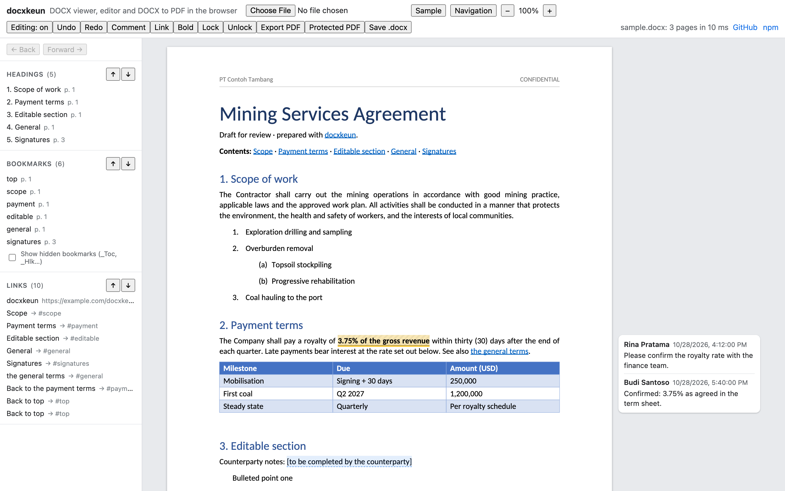

# docxkeun

[](https://github.com/kevinkjs/docxkeun/actions/workflows/ci.yml)
[](https://www.npmjs.com/package/docxkeun)
[](LICENSE)

A DOCX viewer, editor and DOCX-to-PDF converter for JavaScript and TypeScript. Read, render, edit and convert `.docx` files in the browser (and Node), with **zero runtime dependencies**. Everything is implemented in this package: zip, XML, the document model, a page layout engine, an SVG viewer, a PDF writer, and the cryptography for password-protected files.

**[Live demo](https://kevinkjs.github.io/docxkeun/)**: open a `.docx`, type on the page, add comments, export a PDF.

[](https://kevinkjs.github.io/docxkeun/)

> **Beta.** docxkeun is new. It is tested against its own test suite and independent implementations, but not yet broadly against files made by Microsoft Word. See [Status and limitations](#status-and-limitations), and please [report](https://github.com/kevinkjs/docxkeun/issues) documents that render or save wrongly.

| Area | What you get |
|---|---|
| Read / write | Open `.docx` (also `.dotx`/`.docm`), edit through a code API, save. Parts you did not touch are written back byte-for-byte; unknown markup is preserved. |
| Render | Paginated, Word-like layout: styles, lists, tabs, tables, sections, columns, headers/footers, footnotes, page numbers, inline images. One SVG per page with real, selectable text. |
| PDF | Native PDF from the same layout: embedded font subsets, searchable text, links, bookmarks as named destinations, an outline from headings, comments as annotations. |
| Permissions | Word protection (read-only / comments / tracked changes / forms) with editable ranges, an app-level `AccessPolicy`, password-to-open `.docx` encryption, PDF passwords and permission flags. |
| Comments, anchors, links | Threaded comments (all five Word comment parts), bookmarks, internal and external hyperlinks, field-code links. |

## Install

```bash
npm install docxkeun docxkeun-fonts
```

`docxkeun-fonts` is optional (about 7 MB of open fonts, see [Fonts](#fonts)); without it the viewer measures the browser's own fonts, and PDF export needs font files you provide.

| Import | What it contains |
|---|---|
| `docxkeun` | Open, create and save documents; fonts; layout; comments |
| `docxkeun/editor` | `DocxEditor`: the code API for changes |
| `docxkeun/viewer` | `DocxViewer`, typing on the page, navigation |
| `docxkeun/pdf` | `exportPdf` |
| `docxkeun/security` | Protection, `AccessPolicy`, password-to-open, PDF security |
| `docxkeun/react` | React binding (bring your own React) |

**Runtime support:** current Chrome, Edge, Firefox and Safari (16.4+), and Node 20.12+. docxkeun is ESM-only; Node 22.12+ can also `require()` it.

## Quick start

```ts
import { openDocx, FontRegistry, loadBundledFonts } from 'docxkeun';
import { DocxViewer } from 'docxkeun/viewer';
import { fontUrls } from 'docxkeun-fonts';

const fonts = new FontRegistry();
await loadBundledFonts(fonts, { urls: fontUrls });       // see "Fonts" below

const viewer = new DocxViewer(document.getElementById('viewer')!, { fonts });
await viewer.load(fileFromInput);                       // Uint8Array | ArrayBuffer | Blob
viewer.on('linkclick', (e) => console.log(e.target));   // call e.preventDefault() to handle it yourself
viewer.scrollToAnchor('payment');                       // bookmarks
```

Without registered fonts the viewer still works: it measures the viewer's system fonts with the canvas API. Exact layout and PDF export need font files.

### Jumping between bookmarks, links and headings

```ts
const { headings, bookmarks, links } = viewer.navigation;   // each in document order, with page and position
viewer.goTo(bookmarks[0], { history: true });                // scroll there; the target briefly lights up
viewer.next('link');      viewer.previous('link');           // also 'bookmark' and 'heading'
viewer.back();            viewer.forward();                  // like a browser, after following an internal link
viewer.on('navigate', ({ target, location }) => highlightInMyPanel(target));
```

- Clicking an internal link jumps to its bookmark and records history, so `back()` returns to the link.
- Each link target has its text (`label`), its `link` (URL or bookmark name) and, for internal links, its `destination`. A link that wraps onto two lines is one target.
- Links in headers and footers are left out, since they repeat on every page.
- Bookmarks whose names start with `_` (`_Toc…`, `_Hlk…`, `_GoBack`) are marked `hidden`, as Word hides them. `next`/`previous` skip them unless you pass `{ includeHidden: true }`.
- `collectNavTargets(layout)` from `docxkeun/viewer` gives the same lists without a viewer (e.g. in Node).

The playground shows these lists in a side panel, with ↑/↓ buttons per kind, Back/Forward, and Alt+←/→.

### Typing on the page

```ts
const viewer = new DocxViewer(el, { fonts, editable: true });   // or { editable: { guard: policy } }
viewer.on('editerror', ({ error }) => toast(error.message));     // e.g. PermissionError under read-only protection
viewer.editing!.undo();
viewer.setEditable(false);                                       // back to view-only
```

Click to place the caret and type. Supported: text and IME input, Backspace/Delete (Alt/Ctrl for words), Enter (new paragraph, following the style's "next" style), Shift+Enter (line break), Tab, arrow keys, Home/End, Shift to select, double-click a word, drag to select, Cmd/Ctrl+A, copy/cut/paste as plain text, Cmd/Ctrl+B/I/U on a selection, Cmd/Ctrl+Z / Shift+Z / Y for undo and redo, and Cmd/Ctrl-click to follow a link. Every change goes through `DocxEditor`, so the same access guard applies and everything the editor does not understand stays in the file.

### Editing from code

```ts
import { DocxEditor } from 'docxkeun/editor';

const editor = new DocxEditor(viewer.document!);       // the viewer re-renders on every change

editor.fillTemplate({ name: 'PT Contoh', amount: 'USD 1,200' }); // {{name}} even when split across runs, plus content controls by tag
const [match] = editor.find('royalty rate');
editor.formatRange(match, { bold: true, color: 'C00000' });
await editor.addHyperlink(match, { url: 'https://example.com/terms' });
editor.addBookmark(editor.find('Payment terms')[0], 'payment');
await editor.addHyperlink(editor.find('see payment')[0], { bookmark: 'payment' });

// Comments on the user's selection in the viewer
const range = editor.rangeFromSelection(viewer.getSelection()!);
const id = await editor.addComment(range, { author: 'Rina Pratama', text: 'Confirm with finance' });
await editor.replyToComment(id, { author: 'Budi', text: 'Confirmed.' });
await editor.resolveComment(id);

const bytes = await viewer.document!.save();
```

Also available: `insertText`, `appendText`, `replaceRange`, `replaceAll`, `deleteRange` (across paragraphs), `insertParagraph`, `deleteParagraph`, `setParagraphStyle`, `removeHyperlink`, `hyperlinks()`, `bookmarks()`, `removeBookmark`, `editComment`, `deleteComment`, `addEditableRange`, `removeEditableRange`.

### PDF

```ts
import { exportPdf } from 'docxkeun/pdf';
import { pdfSecurity } from 'docxkeun/security';

const pdf = await exportPdf(doc, { fonts, layout: viewer.layout });   // reuse the on-screen layout

const locked = await exportPdf(doc, {
  fonts,
  encryption: pdfSecurity({ userPassword: 'open-me', permissions: { copy: false, print: 'lowQuality' } }),
});
```

### Permissions

```ts
import { AccessPolicy, setProtection, readProtection } from 'docxkeun/security';

// Word's own protection (stored in the file, honoured by Word)
await setProtection(doc, 'readOnly', { password: 'owner-secret' });
editor.addEditableRange(editor.find('[counterparty notes]')[0], { group: 'everyone' });
editor.addEditableRange(editor.find('Budi only')[0], { editor: 'budi@example.com' });

// App-level roles, combined with the document's protection
const policy = new AccessPolicy(doc, { user: { id: 'budi@example.com', name: 'Budi' }, role: 'editor' });
const guarded = new DocxEditor(doc, policy);       // every call is checked; throws PermissionError
policy.can('comment');                             // for enabling UI
new DocxViewer(el, { fonts, highlightRange: policy.highlightRange }); // shade what this user may edit
```

Roles: `viewer` (read, export), `commenter` (comments; edit/delete own), `editor` (edits, subject to document protection and editable ranges), `owner` (everything, including protection).

### Locked regions

Lock specific text against editing while the rest of the document stays editable (the opposite of editable ranges). Locks are Word content controls marked "contents cannot be edited", so Word enforces them too, without turning on document protection.

```ts
const id = editor.lockRange(editor.find('3.75% of the gross revenue')[0], { title: 'Agreed royalty rate' });
editor.lockParagraphs(firstPara, lastPara, { title: 'Signature clause', mode: 'contentAndControl' });
editor.lockedRegions();    // [{ id, mode, title, text, block, el }], including locks Word wrote
editor.unlock(id);
```

- Any edit that touches locked text throws `LockedRegionError`: typing, delete, replace, formatting, links, splitting or joining paragraphs. So does deleting a range that contains a whole locked region. Typing on the page reports it through the viewer's `editerror` event.
- Comments, bookmarks and reading are still allowed.
- Typing right at the edge of a locked region goes just outside it, and Enter at the start or end of a locked block adds a paragraph outside it, as in Word.
- `mode`:
  - `'content'` (default): the text can't be edited.
  - `'contentAndControl'`: it also can't be deleted.
  - `'control'`: it can't be deleted, but its text can be edited.
- Inside one paragraph the exact text is locked. A range across paragraphs locks those whole paragraphs.
- `fillTemplate` and `fillContentControls` skip locked placeholders unless you pass `{ includeLocked: true }`.
- With an `AccessPolicy`, only owners can lock or unlock.
- The viewer shades locked text with a light hatch; turn that off with `showLockedRegions: false`.
- Like Word's own locks, this stops edits in Word and docxkeun, but anyone with Word can still change a control's properties. To make that impossible as well, also turn on document protection.

### Password-to-open `.docx`

```ts
import 'docxkeun/security';                         // enables encrypted files in open/save

const doc = await openDocx(bytes, { password });   // PasswordRequiredError / WrongPasswordError
const encrypted = await doc.save({ password: 'new-password' });
```

Encryption is MS-OFFCRYPTO Agile (AES-256-CBC, SHA-512, 100,000 rounds, HMAC integrity), the same scheme Word uses. Office 2007 "Standard" encryption can be read.

### React

```tsx
import * as React from 'react';
import { createDocxViewerComponent } from 'docxkeun/react';
const DocxView = createDocxViewerComponent(React);  // no React dependency in docxkeun itself

<DocxView file={bytes} fonts={fonts} onReady={(viewer) => setViewer(viewer)} />
```

## Fonts

Word documents name fonts (Calibri, Times New Roman...) but rarely contain them, and browsers cannot read the system's font files. For exact layout and for PDF export, layout needs font files in a `FontRegistry`.

The companion package [`docxkeun-fonts`](packages/fonts/README.md) has open fonts with the same character widths as Office's defaults (SIL OFL 1.1, about 7 MB, 20 files): Carlito for Calibri, Caladea for Cambria, Liberation Sans for Arial, Liberation Serif for Times New Roman, Liberation Mono for Courier New. Those names map automatically.

```ts
import { fontUrls } from 'docxkeun-fonts';

// Browser: bundlers (Vite, webpack 5, Rollup) copy the font files into your build
await loadBundledFonts(fonts, { urls: fontUrls });
await loadBundledFonts(fonts, { urls: fontUrls, families: ['Carlito'] });

// Hosting the .ttf files yourself
await loadBundledFonts(fonts, { baseUrl: 'https://cdn.example.com/docxkeun-fonts/' });

// Node
import { readFile } from 'node:fs/promises';
await loadBundledFonts(fonts, { load: (file) => readFile(fontUrls[file]) });
```

Load only the families you need with `families` to save bandwidth (Carlito alone is 2.7 MB; Caladea is 330 KB). Other options:
- `registry.alias('Corporate Sans', 'Liberation Sans')` maps any other name.
- Fonts embedded in the document are supported: `await registerEmbeddedFonts(doc, registry)`.
- `registry.fallbacks = ['Carlito']` sets what unknown fonts use.

TrueType, OpenType (CFF) and `.ttc` collections are supported. PDF embedding respects a font's "restricted license" flag.

## Security model, honestly

- **Password-to-open `.docx` and PDF user passwords are real encryption** (AES-256).
- **Word document protection, editable ranges, PDF permission flags and `AccessPolicy` are restrictions, not encryption.** Word and PDF viewers honour them, but anyone can strip them from a file, and client-side checks can be bypassed. If your server stores documents, re-check permissions there before accepting changes.
- Documents are untrusted input. All text is escaped when rendered, external links only open with allowed schemes (`http:`, `https:`, `mailto:`, `tel:` by default), images referenced by URL are not loaded unless you opt in, and the XML parser never expands external entities.

## Status and limitations

Working and tested (98 tests): zip/XML/OPC round-trips, styles and numbering, layout and pagination, viewer, editing, comments, links, bookmarks, PDF export, document protection, access policy, `.docx` encryption, PDF encryption.

Verified against independent implementations so far:
- Crypto primitives against FIPS/RFC test vectors and Node's crypto.
- PDF output and AES-256 PDF encryption opened by Chrome's PDF viewer (with and without an open password).

**Still to verify against files made by Microsoft Word:** layout fidelity (line and page breaks), the Word protection password hash (the Excel-compatible low half is confirmed), and opening docxkeun-encrypted files in Word / decrypting Word-encrypted files.

Not yet supported:
- Text wrapping around floating images and text boxes. Floating images are placed but text does not flow around them; DrawingML shapes and text boxes are not drawn.
- Right-to-left text and complex-script shaping (Arabic, Hebrew, Indic), ligatures and GPOS kerning.
- EMF/WMF, GIF and BMP images (drawn as placeholders in PDF), charts, SmartArt, equations (shown as plain text).
- Recording tracked changes. Existing insertions are shown and deletions hidden.
- Column balancing on continuous section breaks.
- In-page typing re-lays out the whole document on every keystroke (about 20–35 ms for a few pages), so very long documents will feel slow. Typing into headers, footers, footnotes and text boxes is not supported, there is no formatting toolbar beyond the shortcuts, pasting keeps text only, and the caret does not yet move through images.

## Development

```bash
pnpm install
pnpm test        # vitest
pnpm dev         # playground at http://localhost:5199
pnpm build       # dist/
```

Tests and the playground use the fonts in `packages/fonts`. Two optional checks compare them with Arial and Times New Roman when those are installed. See [CONTRIBUTING.md](CONTRIBUTING.md) for how to contribute and release, and [SECURITY.md](SECURITY.md) to report a vulnerability.

## License

[MIT](LICENSE) © Kevin Jeremia. The fonts in `docxkeun-fonts` are under the SIL Open Font License 1.1.
